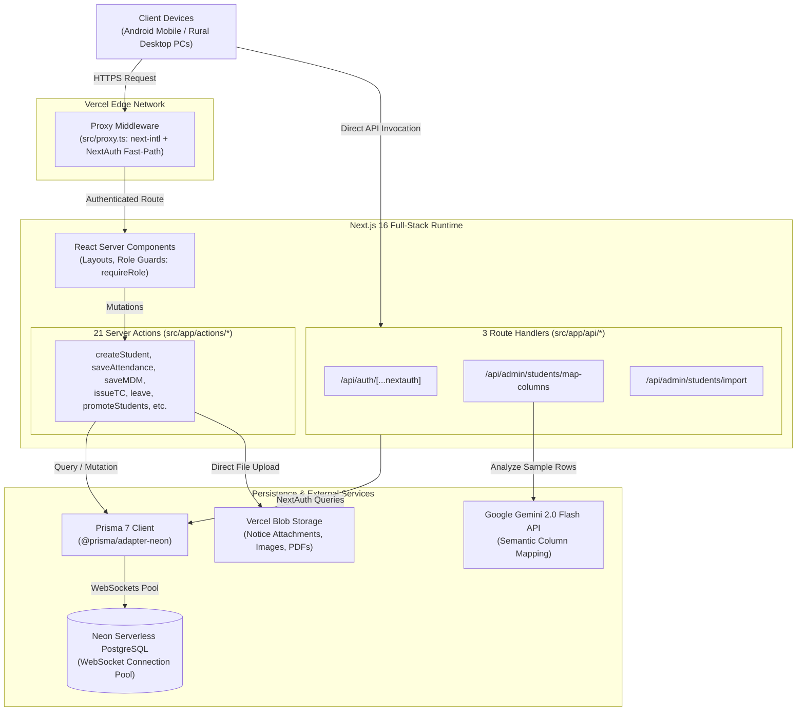
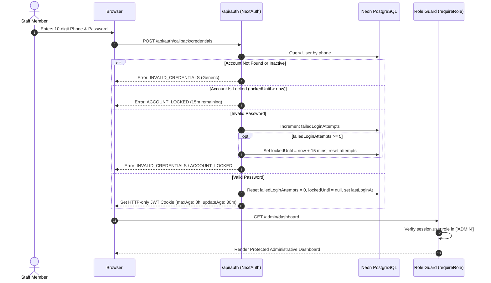
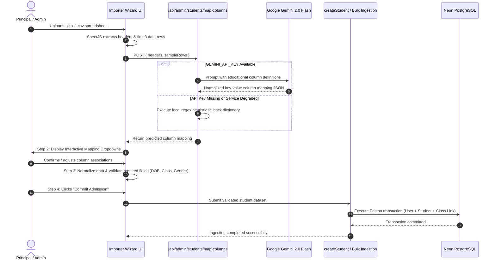
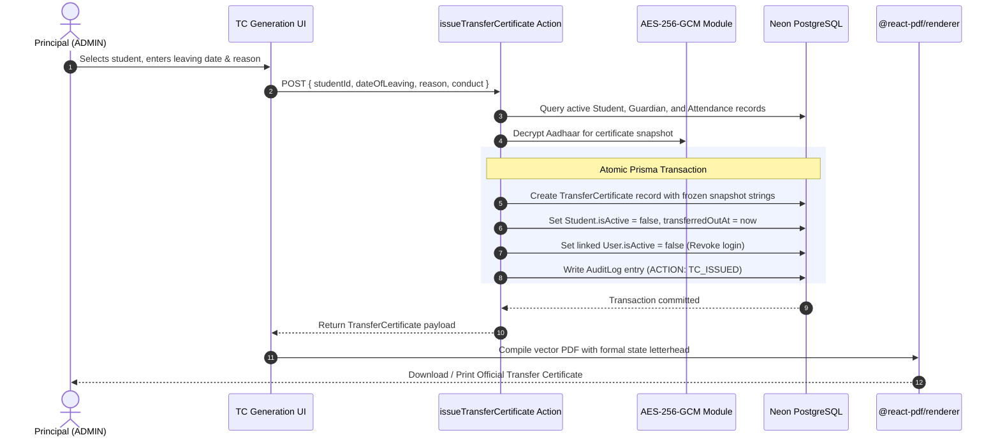
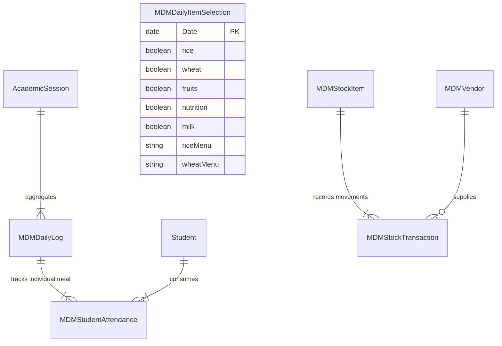
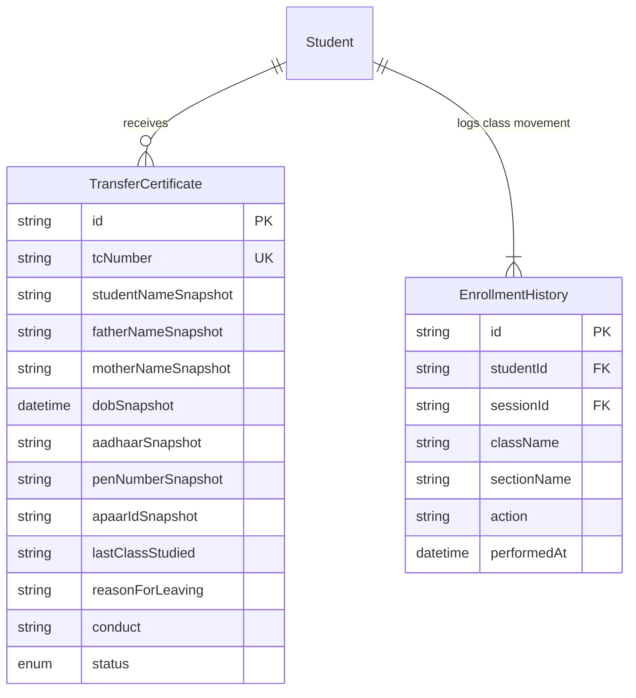
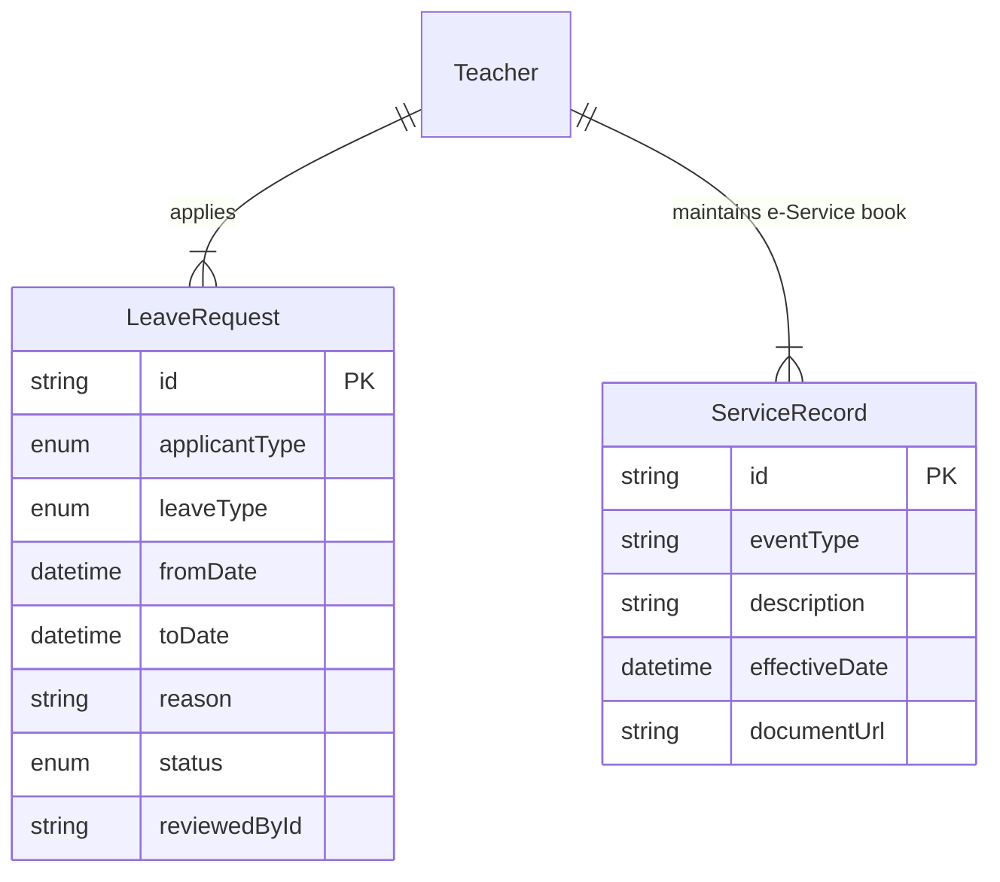

# Composite Vidyalaya ERP

Institutional bilingual school management and statutory reporting platform for Uttar Pradesh government composite schools (Classes 1 to 8).

[](https://composite-vidyalaya-erp.vercel.app)
[](LICENSE)
[](https://nextjs.org/)
[](https://www.typescriptlang.org/)
[](https://www.prisma.io/)
[](https://neon.tech/)
[](https://github.com/shrisha337-beep/composite-vidyalaya-erp/commits/main)

### Live Demo
- Production URL: [https://composite-vidyalaya-erp.vercel.app](https://composite-vidyalaya-erp.vercel.app)
- Administrator (Principal): Phone `[DEMO_PHONE]` / Password `[DEMO_PASSWORD]` (Default seeded test account: `9999999999` / `ChangeMe@123`)
- Instructional Faculty (Teacher): Phone `[DEMO_PHONE]` / Password `[DEMO_PASSWORD]` (Default seeded test account: `9876543210` / `ChangeMe@123`)

---

## Table of Contents
1. [Overview](#1-overview)
2. [Screenshots](#2-screenshots)
3. [Features](#3-features)
4. [Tech Stack](#4-tech-stack)
5. [System Architecture](#5-system-architecture)
6. [Key Flows](#6-key-flows)
7. [Database Design](#7-database-design)
8. [Security](#8-security)
9. [Bilingual Support](#9-bilingual-support)
10. [Project Structure](#10-project-structure)
11. [Getting Started](#11-getting-started)
12. [Environment Variables](#12-environment-variables)
13. [Scripts](#13-scripts)
14. [Deployment](#14-deployment)
15. [Design Decisions](#15-design-decisions)
16. [Status and Roadmap](#16-status-and-roadmap)
17. [Contributing, License, and Author](#17-contributing-license-and-author)

---

## 1. Overview

Government composite schools under the Uttar Pradesh Basic Shiksha Parishad educate students across Primary (Classes 1 to 5) and Upper Primary / Junior (Classes 6 to 8) tiers. These institutions operate under unique administrative conditions:

- **Complex Statutory Mandates:** Daily food grain rations and conversion budgets under the Pradhan Mantri Poshan Shakti Nirman (Mid-Day Meal / MDM) scheme differ by student grade tier. Monthly physical ledgers must be reconciled against Public Distribution System (PDS) grain supplies for the Block Education Officer (BEO).
- **Manual Paper Burden:** Student admissions, Transfer Certificates (TC), attendance rosters, and teacher leave registers are maintained on paper counterfoils, causing high error rates and legibility issues.
- **Data Fragmentation:** Student enrollment data arrives from disparate external portals (UP Prerna, Sharda, U-DISE+) and local spreadsheets with mixed Hindi/English headings and arbitrary column order.
- **Hardware Realities:** School staff access applications on entry-level desktop machines or smartphones over low-bandwidth rural mobile networks.

### User Roles and Scope
- **Active Accounts (12 to 15 Users):** Restricted strictly to the Headmaster/Principal (`ADMIN`) and Assistant Teachers (`TEACHER`). Staff authenticate via phone number and password to mark daily attendance, input marks, inspect rosters, download inspection registers, and manage leave.
- **Centrally Managed Records (300+ Students):** Students and parents do **not** have login accounts by deliberate architectural design (reference [ADR-009](file:///e:/composite-vidyalaya-erp/DECISION.md#L319-L323)). This decision eliminates credential distribution overhead for young rural pupils, minimizes attack surfaces, and keeps administrative focus on institutional governance.
- **The Outcome:** A unified, server-rendered portal replacing physical ledgers with automated two-tier calculations, tamper-proof legal PDF certificate generation, and an AI-powered spreadsheet ingestion pipeline.

---

## 2. Screenshots

> Note: All data shown in screenshots represents simulated, anonymized test records. No real student Personally Identifiable Information (PII) is committed to this repository.

| View | Description | File Path |
|---|---|---|
| Login Portal | Dual-language authentication with phone and password | `/docs/screenshots/01-login.png` |
| Admin Dashboard | Bento grid overview of attendance, MDM grain status, and staff actions | `/docs/screenshots/02-admin-dashboard.png` |
| Student Directory | Class 1 to 8 enrollment roster with multi-column filtering and search | `/docs/screenshots/03-student-directory.png` |
| Importer Wizard | 4-step AI-assisted spreadsheet column mapping and validation preview | `/docs/screenshots/04-importer-wizard.png` |
| Attendance Register | Daily attendance interface with demographic Boys/Girls breakdown | `/docs/screenshots/05-attendance.png` |
| Mid-Day Meal (MDM) | Two-tier statutory daily meal logging and monthly grain consumption ledger | `/docs/screenshots/06-mdm.png` |
| Transfer Certificate | Bilingual legal counterfoil generator and vector PDF preview | `/docs/screenshots/07-transfer-certificate.png` |
| Leave Management | Teacher leave tracker enforcing the 14-day annual Casual Leave cap | `/docs/screenshots/08-leave.png` |
| Notices & Circulars | Institutional broadcast notice board with multi-file attachment support | `/docs/screenshots/09-notices.png` |

<!-- TODO: Capture application screenshots and place PNG files into /docs/screenshots/ matching the filenames above -->

---

## 3. Features

### Authentication and RBAC
- Phone number credentials authentication matching rural staff operational workflows with Bcrypt password hashing.
- Dual-layer access control enforcing immediate edge proxy redirects (`src/proxy.ts`) alongside server-side role verification (`src/lib/rbac.ts`) within protected route layouts.
- Database-backed account lockout locking accounts for 15 minutes after 5 consecutive failed attempts, surviving serverless restarts.

### Student Management and Session Promotion
- Comprehensive student profiles modeling rural addresses, caste categories, ration card status, parent contact info, and bank details.
- Immutable academic movement log (`EnrollmentHistory`) tracking initial admissions, class promotions, retentions, and pass-outs.
- Academic session promotion tool (`/admin/students/promote`) enabling bulk progression of students across academic sessions.

### AI Spreadsheet Importer
- Automated semantic column recognition powered by Google Gemini 2.0 Flash (`/api/admin/students/map-columns`), resolving Hindi headers (e.g., "छात्र का नाम", "पंजीयन संख्या") and colloquial abbreviations.
- Deterministic regex heuristic fallback ensuring operational continuity when offline or when external AI quotas are exhausted.
- 4-step guided review wizard: File Upload, Interactive Dropdown Mapping, Tabular Data Validation Preview, and Atomic Prisma Transaction Commit.

### Attendance and Analytics
- Daily attendance marking across standard attendance states: Present, Absent, Late, Half-Day, Leave, and Holiday.
- Real-time demographic analytics calculating attendance counts and percentages split by gender (Boys/Girls) across day, month, and session views.
- Historical attendance correction allowing teachers to backfill or adjust previously recorded class registers.

### Printable Registers and Timetable
- Official printable attendance registers split into Primary (Classes 1 to 5) and Junior (Classes 6 to 8) sections with sub-totals, rate percentages, and signature lines for inspecting officers.
- Dedicated 8-period printable timetable grid with mid-day recess break, teacher assignments, and formal institutional header.
- Clean vector print stylesheets excluding navigation bars, sidebars, and browser chrome during printing.

### Mid-Day Meal (MDM) Engine
- Encodes statutory UP Basic Shiksha Parishad two-tier formulas: Primary (100g grain / ₹6.78 conversion cost) and Junior (150g grain / ₹10.17 conversion cost).
- Tracks Friday fruit distribution (₹4.00/child), supplementary nutrition (₹5.00), and daily milk distribution volume (150 mL Primary, 200 mL Junior).
- Daily meal counts synchronize automatically with verified classroom attendance, eliminating manual headcount calculations and updating monthly grain stock balances.

### Transfer Certificate (TC) Engine
- Server-side bilingual (Hindi/English) vector PDF generation using `@react-pdf/renderer` formatted to standard state government letterhead.
- Freezes legal demographic and academic snapshots at issuance time, ensuring subsequent edits to active student records cannot tamper with historical certificates.
- Supports non-legal field re-editing with an audit log trail, and full certificate revocation with student profile re-activation.

### Teacher Leave Management
- Structured leave types covering Casual Leave (CL), Medical Leave (ML), Child Care Leave (CCL), Maternity Leave (MAT), and Abortion Leave (AL).
- Enforces a statutory 14-day annual cap on Casual Leave with automatic submission blocking once exhausted.
- Gender-restricted access for maternal and child care categories, coupled with administrative backfill capabilities for past manual leaves.

### Notices with Vercel Blob Attachments
- Administrative bulletin board supporting broadcasts to all staff or targeted specific classes.
- Direct multi-file uploads for up to 5 attachments (PDFs, JPEG, PNG, WebP) backed by Vercel Blob storage.
- Dedicated download panel on the teacher portal for rapid inspection of government orders and departmental circulars.

### School Settings
- Centralized configuration for institutional identifiers: School Name, UDISE Code (`09530607202`), Block (`Paraspur`), and District (`Gonda`).
- Configurable statutory MDM rates allowing administrators to adjust conversion costs without code changes when government circulars update rates.
- Default locale management and official state department logo links.

### Marks Entry
- State-compliant continuous evaluation schema: Unit Test 1 (10 marks) + Unit Test 2 (10 marks) + Half-Yearly (30 marks) + Annual Exam (50 marks) = 100 total marks.
- Subject-wise and term-wise tabular entry interface scoped to class teachers.
- Database uniqueness constraints preventing duplicate marks records per subject, term, and academic session.

---

## 4. Tech Stack

| Layer | Technology | Purpose |
|---|---|---|
| **Core Framework** | [](https://nextjs.org/) | Full-stack App Router, React Server Components (RSC), and Server Actions |
| **Language & Runtime** | [](https://www.typescriptlang.org/) | End-to-end static typing across database schemas, APIs, and UI components |
| **Frontend UI Library** | [](https://react.dev/) | Concurrent UI rendering and component architecture |
| **Styling Engine** | [](https://tailwindcss.com/) | Zero-runtime CSS design system with custom institutional maroon/beige theme |
| **UI Primitives** | [](https://www.radix-ui.com/) | Accessible unstyled primitives for labels and slot delegation |
| **Database ORM** | [](https://www.prisma.io/) | Type-safe query builder and data modeling with `@prisma/adapter-neon` |
| **Database Engine** | [](https://neon.tech/) | Serverless PostgreSQL with WebSocket pooling and instant connection scaling |
| **Authentication** | [](https://next-auth.js.org/) | Phone credentials provider, CSRF mitigation, and rolling 8-hour JWT sessions |
| **Internationalization** | [](https://next-intl-docs.vercel.app/) | Bilingual route handling (`/hi/`, `/en/`) with server-side message loading |
| **Runtime Validation** | [](https://zod.dev/) | Strict runtime schema parsing for form payloads, server actions, and imports |
| **Document Generation** | [](https://react-pdf.org/) | Server-side vector PDF generation for Transfer Certificates |
| **Artificial Intelligence** | [](https://ai.google.dev/) | Semantic column header resolution for unstructured student spreadsheets |
| **Cloud File Storage** | [](https://vercel.com/docs/storage/vercel-blob) | Token-authorized cloud object storage for notice PDF and image attachments |
| **Spreadsheet Engine** | [](https://sheetjs.com/) | In-memory extraction and parsing of `.xlsx` and `.csv` legacy spreadsheets |
| **Hosting Platform** | [](https://vercel.com/) | Edge-routed deployment running serverless Next.js functions |

---

## 5. System Architecture



### Architecture Notes
- **Server-First RSC Rendering:** HTML is streamed directly from the server, eliminating large JavaScript bundle downloads on rural 3G/4G connections and ensuring instant First Contentful Paint.
- **21 Server Actions:** Business operations (admissions, attendance, marks, leaves, promotions, certificates) execute as transactional server functions with direct database connectivity.
- **3 Dedicated Route Handlers:** Authentication endpoints, streaming multipart student imports, and Gemini AI column detection run through specialized route handlers.

---

## 6. Key Flows

### A. Authentication, Lockout, and Rolling JWT



### B. 4-Step AI Student Spreadsheet Ingestion



### C. Transfer Certificate (TC) Issuance with Legal Snapshot



---

## 7. Database Design

The schema is defined across **41 models** in [prisma/schema.prisma](file:///e:/composite-vidyalaya-erp/prisma/schema.prisma).

### Core Entity Relationships

```mermaid
erDiagram
    User ||--o| AdminProfile : "has profile"
    User ||--o| Teacher : "has profile"
    User ||--o| Student : "has profile"
    User ||--o{ AuditLog : "initiates"

    AcademicSession ||--|{ Class : "defines"
    AcademicSession ||--|{ Attendance : "scopes"
    AcademicSession ||--|{ Mark : "scopes"
    AcademicSession ||--|{ MDMDailyLog : "records"

    Class ||--|{ Section : "subdivides"
    Class ||--|{ Subject : "teaches"

    Section ||--o{ Student : "contains"
    Teacher ||--o{ Section : "acts as class teacher"

    Student ||--|{ Attendance : "records daily status"
    Student ||--|{ Mark : "achieves"
    Student ||--|{ Guardian : "linked to"
    Student ||--|{ Sibling : "linked to"
    Student ||--o| BankDetail : "stores DBT account"
    Student ||--o{ TransferCertificate : "issued"
    Student ||--o{ EnrollmentHistory : "tracks movement"

    Teacher ||--|{ TeacherSubject : "assigned"
    Teacher ||--|{ LeaveRequest : "applies"
    Teacher ||--|{ ServiceRecord : "logs eHRMS entry"

    Notice ||--o{ NoticeAttachment : "includes files"
    Notice ||--o{ Notification : "dispatches"
```

### Module Sub-Schemas

#### Mid-Day Meal (MDM) Module


#### Transfer Certificate & Movement Lifecycle


#### Faculty Service & Leave Module


### Digitized Government Forms & Registries
1. **UP Basic Shiksha Parishad Chhatra Pravesh Form (छात्र प्रवेश आवेदन पत्र):** Sibling enrollment, structured rural addresses, caste/sub-caste categories, disability classifications, and ration card status.
2. **Direct Benefit Transfer (DBT) Bank Passbook Register:** Bank account details, IFSC, Aadhaar seeding validation, and guardian linkages for state subsidies.
3. **PM POSHAN Daily & Monthly Consumption Registers:** Primary vs Junior two-tier rations, conversion costs, Friday fruits, milk distributions, and PDS grain inventory transactions.
4. **UP Transfer Certificate (TC) Counterfoil Register:** Official serial registration numbers (`tcNumber`), academic attendance days, promotion decisions, and reason for leaving.
5. **National & State Student Portals (U-DISE+, UP Prerna, Sharda):** Permanent Education Numbers (PEN), APAAR IDs, and institutional UDISE identifiers (`09530607202`).
6. **Continuous and Comprehensive Evaluation (CCE) Exam Register:** 100-mark statutory structure (Unit Test 1, Unit Test 2, Half-Yearly, Annual).
7. **Manav Sampada (eHRMS) Service & Leave Register:** 14-day Casual Leave limit enforcement, medical and maternity leave accounting, and designation records.

---

## 8. Security

- **Dual-Layer Defense-in-Depth RBAC:** Implements access control at two distinct boundaries:
  - *Layer 1 (Fast-Path UX):* Edge proxy middleware (`src/proxy.ts`) bounces unauthenticated requests to `/login`.
  - *Layer 2 (Authoritative Security Gate):* Server-side `requireRole(["ADMIN" | "TEACHER"])` checks executed within Server Component layouts (`src/lib/rbac.ts`) and Server Actions.
- **CVE-2025-29927 Vulnerability Mitigation:** Middleware-only security in Next.js can be bypassed using internal subrequest headers (`x-middleware-subrequest`). Requiring authorization within the Server Component layout tree guarantees that unauthorized requests are terminated on the server regardless of incoming client headers.
- **Database-Backed Account Lockout:** Accounts are locked for 15 minutes after 5 consecutive failed login attempts. State is persisted in PostgreSQL (`failedLoginAttempts`, `lockedUntil` columns on `User`), ensuring lockouts survive serverless cold starts and are enforced across all Vercel function instances.
- **In-Memory IP Rate Limiting:** Supplements database lockout with client IP rate limiting (`src/lib/ip-rate-limit.ts`) to throttle automated brute-force attacks.
- **Rolling JWT Session Strategy:** Sessions run on signed JWTs with a maximum lifetime of **8 hours** (aligned with a school working day rather than default 30-day sessions), rolling forward every **30 minutes** on user activity. Role claims are embedded in the token to prevent database round-trips on every page render.
- **AES-256-GCM Field-Level PII Encryption:** Sensitive national identifiers (Student Aadhaar, Guardian Aadhaar, and Bank Account Numbers) are encrypted at the application layer ([src/lib/encryption.ts](file:///e:/composite-vidyalaya-erp/src/lib/encryption.ts)) using 256-bit AES-GCM with unique 96-bit initialization vectors. Values are stored as authenticated strings (`enc:v1:<iv>:<tag>:<ciphertext>`), protecting data even if database dumps are compromised.
- **Uniform Authentication Errors:** Generic error codes (`INVALID_CREDENTIALS`) are returned for both nonexistent phone numbers and incorrect passwords, preventing username enumeration.
- **Input Sanitization and Validation:** All form submissions, URL search params, and import rows are parsed against strict **Zod** schemas.
- **Data Privacy Assurance:** This repository contains zero real student data. All seeded data and test fixtures utilize synthetic names and dummy identifiers.

---

## 9. Bilingual Support

The portal is built with `next-intl` to support seamless dual-language usage, reflecting the working language of Uttar Pradesh state educators:

- **Routing Architecture:** Locales are managed via dynamic route segments (`/[locale]/...`).
- **Default Locale:** **Hindi (`hi`)** is the primary default locale; **English (`en`)** is available as an alternate.
- **Parallel UI Typography:** Forms and administrative dashboards utilize parallel bilingual labeling (e.g., *"माता का नाम (Mother's Name)"*, *"जाति (Category)"*, *"उपस्थिति (Attendance)"*).
- **Official Documents:** Transfer Certificates and Attendance Registers print with official bilingual Hindi and English institutional headings.

### Adding a New Translation String
1. Add the key and English text to `src/i18n/messages/en.json`:
   ```json
   {
     "dashboard": {
       "myMetric": "Class Average"
     }
   }
   ```
2. Add the corresponding Hindi text to `src/i18n/messages/hi.json`:
   ```json
   {
     "dashboard": {
       "myMetric": "कक्षा का औसत"
     }
   }
   ```
3. Consume the string in a Server Component:
   ```tsx
   import { getTranslations } from "next-intl/server";

   export default async function Page() {
     const t = await getTranslations("dashboard");
     return <h1>{t("myMetric")}</h1>;
   }
   ```

---

## 10. Project Structure

```text
composite-vidyalaya-erp/
├── prisma/
│   ├── migrations/            # Versioned SQL migrations (0_init, add_enrollment_history)
│   ├── schema.prisma          # Domain model with 41 Prisma models
│   └── seed.ts                # Database seed script for test session, admin, and teacher
├── public/                    # Static public assets (favicons, logos)
├── src/
│   ├── app/
│   │   ├── [locale]/          # Bilingual dynamic route root
│   │   │   ├── (auth)/        # Authentication routes (login)
│   │   │   ├── admin/         # Administrator dashboard, students, MDM, reports, settings
│   │   │   ├── teacher/       # Instructional faculty portal (attendance, marks, leaves)
│   │   │   └── unauthorized/  # Access denied landing page
│   │   ├── actions/           # 21 Server Actions for transactional domain operations
│   │   └── api/               # 3 Route Handlers (NextAuth, Gemini mapping, Excel import)
│   ├── components/
│   │   ├── admin/             # Admin-specific forms, reports hub, timetable, TC documents
│   │   ├── auth/              # Phone and password login forms
│   │   ├── teacher/           # Daily attendance view, marks entry, leave panels
│   │   └── ui/                # Core UI primitives (Button, Card, Input, Label)
│   ├── generated/
│   │   └── prisma/            # Generated Prisma 7 Client (gitignored)
│   ├── i18n/
│   │   ├── messages/          # Dictionaries: hi.json (default) and en.json
│   │   ├── navigation.tsx     # Locale-aware Next.js Link and useRouter wrappers
│   │   ├── request.ts         # Request-scoped locale configuration
│   │   └── routing.ts         # Supported locales definition
│   ├── lib/
│   │   ├── auth.ts            # NextAuth configuration and credentials provider
│   │   ├── encryption.ts      # AES-256-GCM field-level encryption module
│   │   ├── ip-rate-limit.ts   # In-memory IP-based rate limiting helper
│   │   ├── mailer.ts          # Resend transactional email integration
│   │   ├── prisma.ts          # Prisma 7 client instance with Neon adapter
│   │   └── rbac.ts            # Server-side requireRole guard using React cache()
│   ├── proxy.ts               # Edge proxy middleware for NextAuth and next-intl
│   └── types/                 # Shared domain TypeScript interfaces
├── DECISION.md                # Architectural Decision Records (ADRs 001-033)
├── package.json               # Node.js dependencies and script definitions
├── prisma.config.ts           # Prisma 7 configuration file declaring connection parameters
└── tsconfig.json              # TypeScript configuration
```

---

## 11. Getting Started

### Prerequisites
- Node.js 20.x or higher
- npm 10.x or higher
- A running PostgreSQL database instance (Neon Serverless PostgreSQL recommended)

### Setup Instructions

1. **Clone the repository:**
   ```bash
   git clone https://github.com/shrisha337-beep/composite-vidyalaya-erp.git
   cd composite-vidyalaya-erp
   ```

2. **Install dependencies:**
   ```bash
   npm install
   ```

3. **Configure environment variables:**
   ```bash
   cp .env.example .env
   ```
   *Edit `.env` and configure your database connection string and cryptographic secrets.*

4. **Generate the Prisma client:**
   ```bash
   npx prisma generate
   ```

5. **Deploy database schema migrations:**
   ```bash
   npx prisma db push
   ```

6. **Seed baseline demonstration data:**
   ```bash
   npx prisma db seed
   ```

7. **Start the local development server:**
   ```bash
   npm run dev
   ```
   Open [http://localhost:3000/hi/login](http://localhost:3000/hi/login) in your browser.

8. **Build for production:**
   ```bash
   npm run build
   ```

---

## 12. Environment Variables

The table below lists all configuration variables parsed from `.env.example` and application source files. Never commit production secrets.

| Variable | Description | Required | Source |
|---|---|---|---|
| `DATABASE_URL` | Neon Serverless PostgreSQL connection string with SSL | Yes | `.env.example` |
| `NEXTAUTH_URL` | Canonical root URL of the deployment (e.g. `http://localhost:3000`) | Yes | `.env.example` |
| `NEXTAUTH_SECRET` | 32-byte secret for JWT signing (`openssl rand -base64 32`) | Yes | `.env.example` |
| `ENCRYPTION_KEY` | 64-character hex key for AES-256-GCM (`openssl rand -hex 32`) | Yes | `.env.example` |
| `GEMINI_API_KEY` | Google AI Studio API key for Gemini 2.0 Flash column mapping | Optional | `.env.example` |
| `BLOB_READ_WRITE_TOKEN` | Vercel Blob access token for multi-file notice uploads | Optional | Vercel Storage |
| `RESEND_API_KEY` | Resend API key for sending password reset emails | Optional | `src/lib/mailer.ts` |
| `FROM_EMAIL` | Sender email address for transactional system notifications | Optional | `src/lib/mailer.ts` |
| `SMS_API_KEY` | SMS gateway API key for future OTP delivery | Optional | `.env.example` |
| `SMS_SENDER_ID` | Approved 6-character DLT sender identifier for SMS | Optional | `.env.example` |
| `NEXT_PUBLIC_APP_URL` | Public application domain used for metadata generation | Optional | `src/app/[locale]/layout.tsx` |

---

## 13. Scripts

All available scripts defined in `package.json`:

| Script | Command | Purpose |
|---|---|---|
| `npm run dev` | `next dev` | Launches the local Next.js development server with Turbopack |
| `npm run build` | `prisma generate && next build` | Compiles Prisma Client and creates the production Next.js build |
| `npm run start` | `next start` | Runs the compiled production application server |
| `npm run lint` | `eslint` | Runs ESLint 9 static code analysis across the codebase |
| `npm run postinstall` | `prisma generate` | Automatically triggers Prisma Client generation after package installation |

---

## 14. Deployment

### Production Deployment (Vercel + Neon + Vercel Blob)

1. **Provision Neon PostgreSQL:**
   - Create a project on [Neon](https://neon.tech).
   - Copy the pooled connection string (`sslmode=require`).

2. **Connect Project to Vercel:**
   - Import the `composite-vidyalaya-erp` repository into [Vercel](https://vercel.com).
   - Set Framework Preset to **Next.js**.

3. **Attach Vercel Blob Storage:**
   - In your Vercel Project Dashboard, navigate to the **Storage** tab.
   - Click **Create Database** and select **Blob**.
   - Vercel automatically injects `BLOB_READ_WRITE_TOKEN` into your environment.

4. **Configure Production Environment Variables:**
   - Add `DATABASE_URL` (from Neon).
   - Add `NEXTAUTH_URL` (your custom domain or `.vercel.app` domain).
   - Add `NEXTAUTH_SECRET` (generate with `openssl rand -base64 32`).
   - Add `ENCRYPTION_KEY` (generate with `openssl rand -hex 32`).
   - Add `GEMINI_API_KEY` (from Google AI Studio).

5. **Initialize Database Schema:**
   - Run the initial schema push and database seed against the production database:
     ```bash
     npx prisma db push
     npx prisma db seed
     ```

6. **Trigger Deployment:**
   - Push to `main` or trigger a manual deploy on Vercel.
   - Verify health by navigating to `/hi/login`.

---

## 15. Design Decisions

Key architectural choices documented in [DECISION.md](file:///e:/composite-vidyalaya-erp/DECISION.md):

- **ADR-001: Next.js App Router & Server Actions:** Adopted server-rendered architecture to minimize client bundles on low-powered school hardware and eliminate client-side state synchronization bugs.
- **ADR-002: Prisma 7 with Neon Serverless Driver Adapter:** Upgraded to Prisma 7 using `@prisma/adapter-neon` over WebSockets to eliminate connection exhaustion in serverless environments.
- **ADR-003: Dual-Layer RBAC Architecture:** Mitigates CVE-2025-29927 by placing mandatory server-side `requireRole()` checks in route layouts rather than trusting edge middleware alone.
- **ADR-005: AES-256-GCM Field-Level PII Encryption:** Aadhaar numbers and bank accounts are encrypted before database persistence, satisfying statutory data protection norms.
- **ADR-007: Hindi as Primary Default Locale:** Configured `hi` as the default locale via `next-intl` to reflect the operational working language of Uttar Pradesh state educators.
- **ADR-009: Exclusion of Student/Parent Direct Logins:** Authentication is strictly restricted to administrative and instructional staff. Students exist purely as data records.
- **ADR-010: Statutory Two-Tier Mid-Day Meal Accounting Engine:** Codifies UP state nutrition quotas (Primary 100g / ₹6.78 vs Junior 150g / ₹10.17) directly into attendance calculations.
- **ADR-012: Hybrid Gemini AI + Regex Heuristic Excel Import Pipeline:** Combines an LLM for semantic header recognition with local regex fallbacks to ensure uninterrupted operation.

### Why There Is No Fee Module
Government composite schools (Classes 1 to 8) under the Basic Shiksha Parishad, Uttar Pradesh operate under the **Right of Children to Free and Compulsory Education (RTE) Act, 2009**. Tuition fees, textbooks, uniforms, and mid-day meals are completely free. Uniform and supply allowances are disbursed directly to parent bank accounts through government **Direct Benefit Transfer (DBT)** portals. Including a student fee collection module would violate state regulatory standards.

---

## 16. Status and Roadmap

### Completed Modules
- [x] Multi-role authentication (Admin / Teacher) with DB-backed account lockout and IP throttling.
- [x] Dual-layer RBAC protecting against Next.js middleware subrequest bypass (CVE-2025-29927).
- [x] Student profile directory with structured addresses and AES-256-GCM encrypted PII fields.
- [x] AI-assisted student spreadsheet importer using Gemini 2.0 Flash with local regex fallback.
- [x] Class promotion engine and immutable session movement history (`EnrollmentHistory`).
- [x] Daily student attendance tracking with gender-wise (Boys/Girls) demographic breakdowns.
- [x] Statutory two-tier Mid-Day Meal accounting engine with grain balance registers and Friday fruit tracking.
- [x] Official Transfer Certificate generator with frozen snapshots, vector PDF rendering, and audit trail.
- [x] Printable official attendance inspection rosters and 8-period timetable grids.
- [x] Teacher leave management enforcing the 14-day annual Casual Leave cap and statutory maternity rules.
- [x] Broadcast notices board with multi-file attachment uploads via Vercel Blob.
- [x] Examination marks entry for the state 10+10+30+50 scoring model.

### In Progress
- [ ] End-of-year aggregated annual report card batch PDF generation (schema supported).
- [ ] Direct SMS gateway integration for attendance alerts (DLT template verification pending).

### Planned
- [ ] Progressive Web App (PWA) offline sync service worker for intermittent rural connectivity.
- [ ] Automated export integration matching official U-DISE+ bulk upload formats.

### Limitations and Quality Notice
- **Automated Tests:** There is currently no automated test suite (Jest/Vitest/Playwright) configured in this repository. Stability is maintained via TypeScript strict mode, comprehensive Zod runtime schema boundaries, and manual user acceptance testing.
- **CI/CD Workflows:** Automated GitHub Actions workflows are not yet configured; deployments are triggered directly via Vercel Git integration.

---

## 17. Contributing, License, and Author

### Contributing
Contributions to improve functionality, accessibility, and documentation are welcome:
1. Fork the repository.
2. Create a feature branch: `git checkout -b feature/improvement-name`.
3. Ensure code conforms to ESLint guidelines: `npm run lint`.
4. Commit your changes: `git commit -m "feat: describe improvement"`.
5. Push to your branch and open a Pull Request.

### License
This project is licensed under the MIT License - see the [LICENSE](LICENSE) file for details.  
*(Note: If a `LICENSE` file is not present in the root directory, this project defaults to proprietary rights reserved by the author).*

### Author
- **Developer:** shrisha337-beep
- **GitHub:** [https://github.com/shrisha337-beep](https://github.com/shrisha337-beep)
- **LinkedIn:** [TODO: Add LinkedIn Profile URL]
- **Email:** [shrisha337@gmail.com](mailto:shrisha337@gmail.com)
